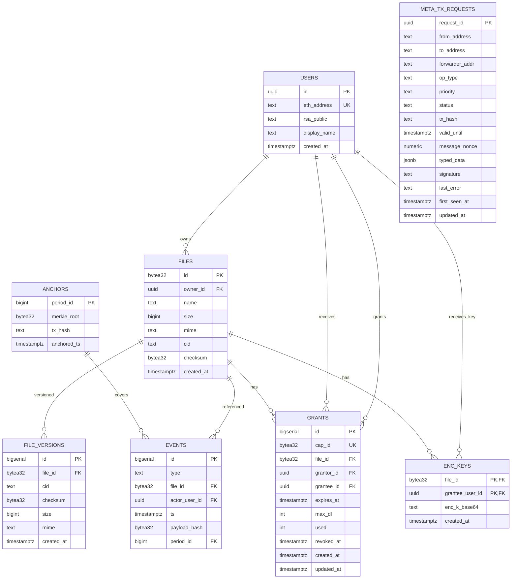

# DFSP — Спецификация модели данных (MVP)

*Версия: 1.0 • Назначение: документация для проектирования БД и API-интеграций.*

## 0) Базовые соглашения

- **Идентификаторы**
  - `UUID` — для внутренних сущностей (пользователь, записи журналов).
  - `bytes32` (hex `0x…64`) — для `fileId`, `capId`, `checksum` (соответствует он-чейн типу `bytes32`).
  - `Address` — адрес EOA `0x…40`.
  - `CID` — строка CIDv1 (Base32).

- **Время** — `timestamptz` (UTC). В API — `RFC3339`.

- **Приватность** — PII не храним (нет e-mail/телефонов). Логи без IP/адресов.

- **Нотация типов**: указываем *логический тип* / *(реком. Postgres)*.

---

## 1) Сущность `users` — Пользователи

**Назначение:** учётные записи без e-mail; вход по PoP (EOA).

| Поле          | Тип (логич./PG)    | PK | NULL | По умолчанию | Описание |
|---            |---                 |---:|---:|---|---|
| `id`          | UUID / `uuid`      | ✅ | ❌ | `gen_random_uuid()` | Внутренний идентификатор |
| `eth_address` | Address / `text`   | ❌ | ❌ | — | `0x…40`, **UNIQUE**, формат-проверка |
| `rsa_public`  | PEM(SPKI) / `text` | ❌ | ❌ | — | Публичный RSA-ключ пользователя |
| `display_name`| string / `text`    | ❌ | ✅ | — | Опциональный псевдоним |
| `created_at`  | datetime / `timestamptz` | ❌ | ❌ | `now()` | Время регистрации |

**Индексы:** `eth_address UNIQUE`.

**Связи:** `files.owner_id → users.id`, `grants.{grantor_id,grantee_id} → users.id`, `enc_keys.grantee_user_id → users.id`.

**API-соответствие:** `auth/register` сохраняет `eth_address`, `rsa_public`.

---

## 2) Сущность `files` — Файлы (метаданные)

**Назначение:** описание зашифрованного файла, зарегистрированного on-chain.

| Поле        | Тип (логич./PG)     | PK | NULL | По умолчанию | Описание |
|---          |---                  |---:|---:|---|---|
| `id`        | bytes32 / `bytea(32)` | ✅ | ❌ | — | `fileId = keccak256(owner||rand||time)` |
| `owner_id`  | UUID / `uuid`       | ❌ | ❌ | — | Владелец (`users.id`) |
| `name`      | string / `text`     | ❌ | ❌ | — | Отображаемое имя файла (UI) |
| `size`      | int64 / `bigint`    | ❌ | ❌ | — | Размер байт (≤ 200 МБ по квоте) |
| `mime`      | string / `text`     | ❌ | ❌ | — | MIME-тип зашифрованного blob |
| `cid`       | CID / `text`        | ❌ | ❌ | — | CIDv1 IPFS |
| `checksum`  | bytes32 / `bytea(32)` | ❌ | ❌ | — | `keccak256(all_ciphertexts_concat)` |
| `created_at`| datetime / `timestamptz` | ❌ | ❌ | `now()` | Дата регистрации |

**Ограничения:**
- `octet_length(id)=32`, `octet_length(checksum)=32`.
- **UNIQUE**: `(owner_id, checksum)` — запрет дубликата шифротекста у одного владельца.

**Индексы:** `(owner_id, created_at DESC)`.

**Связи:** `file_versions.file_id → files.id`, `grants.file_id → files.id`, `enc_keys.file_id → files.id`.

**API-соответствие:** `/files POST` → typedData `register(...)`, `/files GET`, `/files/{id} GET`.

**Пример (API → DB):**
```json
{
  "fileId": "0x4e3b...5d2c",
  "name": "report.enc",
  "size": 104857600,
  "mime": "application/octet-stream",
  "cid": "bafybeigd...",
  "checksum": "0x6a2b9c..."
}
````

---

## 3) Сущность `file_versions` — Версии файла

**Назначение:** история `updateCid` (новый CID/K_file/checksum/size/mime).

| Поле         | Тип                      | PK | NULL | По умолчанию | Описание        |
| ------------ | ------------------------ | -: | ---: | ------------ | --------------- |
| `id`         | serial / `bigserial`     |  ✅ |    ❌ | —            | Внутренний      |
| `file_id`    | bytes32 / `bytea(32)`    |  ❌ |    ❌ | —            | FK → `files.id` |
| `cid`        | CID / `text`             |  ❌ |    ❌ | —            | Новый CID       |
| `checksum`   | bytes32 / `bytea(32)`    |  ❌ |    ❌ | —            | Новый checksum  |
| `size`       | int64 / `bigint`         |  ❌ |    ❌ | —            | Новый размер    |
| `mime`       | string / `text`          |  ❌ |    ❌ | —            | Новый MIME      |
| `created_at` | datetime / `timestamptz` |  ❌ |    ❌ | `now()`      | Дата версии     |

**Индексы:** `(file_id, created_at DESC)`.

**API-соответствие:** `/files/{id}/version POST` → typedData `updateCid(...)`.

---

## 4) Сущность `grants` — Права доступа (on-chain + оффчейн поля)

**Назначение:** управление доступом: TTL, лимиты выдачи ключа (`used/max_dl`), revoke.

| Поле         | Тип                      | PK | NULL | По умолчанию | Описание                          |
| ------------ | ------------------------ | -: | ---: | ------------ | --------------------------------- |
| `id`         | serial / `bigserial`     |  ✅ |    ❌ | —            | Внутренний                        |
| `cap_id`     | bytes32 / `bytea(32)`    |  ❌ |    ❌ | —            | Идентификатор гранта (**UNIQUE**) |
| `file_id`    | bytes32 / `bytea(32)`    |  ❌ |    ❌ | —            | FK → `files.id`                   |
| `grantor_id` | UUID / `uuid`            |  ❌ |    ❌ | —            | Выдавший (FK → `users.id`)        |
| `grantee_id` | UUID / `uuid`            |  ❌ |    ❌ | —            | Получатель (FK → `users.id`)      |
| `expires_at` | datetime / `timestamptz` |  ❌ |    ❌ | —            | Истечение                         |
| `max_dl`     | int / `int`              |  ❌ |    ❌ | —            | Макс. выдач `encK`                |
| `used`       | int / `int`              |  ❌ |    ❌ | `0`          | Сколько `encK` уже выдано         |
| `revoked_at` | datetime / `timestamptz` |  ❌ |    ✅ | —            | Дата отзыва                       |
| `created_at` | datetime / `timestamptz` |  ❌ |    ❌ | `now()`      | Создан                            |
| `updated_at` | datetime / `timestamptz` |  ❌ |    ❌ | `now()`      | Авто-обновление триггером         |

**Ограничения:**

* `octet_length(cap_id)=32`.
* `used <= max_dl`.

**Индексы:** `(grantee_id, expires_at)`, `(file_id)`.

**API-соответствие:**

* `/files/{id}/share POST` → батч typedData `grant(...)`.
* `/grants/{capId} GET` — состояние гранта.
* `/grants/{capId}/revoke POST` → typedData `revoke(...)`.

---

## 5) Сущность `enc_keys` — Доставка K_file (encK)

**Назначение:** хранение **encK (RSA-OAEP-2048/SHA-256)** на получателя и файл (сервер не расшифровывает).

| Поле              | Тип                      |    PK | NULL | По умолчанию | Описание             |
| ----------------- | ------------------------ | ----: | ---: | ------------ | -------------------- |
| `file_id`         | bytes32 / `bytea(32)`    | (PK1) |    ❌ | —            | FK → `files.id`      |
| `grantee_user_id` | UUID / `uuid`            | (PK2) |    ❌ | —            | FK → `users.id`      |
| `enc_k_base64`    | base64 / `text`          |     ❌ |    ❌ | —            | Зашифрованный K_file |
| `created_at`      | datetime / `timestamptz` |     ❌ |    ❌ | `now()`      | Дата записи          |

**Ограничения:** `UNIQUE(file_id, grantee_user_id)`, `length(enc_k_base64) ≥ 32`.

**API-соответствие:** `/files/{id}/share` — принимает `encK_map`, сервер сохраняет.

---

## 6) (Опционально) `deny_ciphertexts` — Глобальный deny-лист

**Назначение:** запрещённые `checksum` на уровне сервиса (по админ-политике).

| Поле       | Тип                      | PK | NULL | По умолчанию | Описание        |
| ---------- | ------------------------ | -: | ---: | ------------ | --------------- |
| `checksum` | bytes32 / `bytea(32)`    |  ✅ |    ❌ | —            | Хеш шифротекста |
| `reason`   | string / `text`          |  ❌ |    ✅ | —            | Причина         |
| `added_at` | datetime / `timestamptz` |  ❌ |    ❌ | `now()`      | Когда добавили  |

**API-соответствие:** `/files POST` — 400 при попадании в deny-лист.

---

## 7) `meta_tx_requests` — Приём и трекинг meta-tx (релейер)

**Назначение:** идемпотентность, статусы, ошибки, `tx_hash` для релейера.

| Поле             | Тип                      | PK | NULL | По умолчанию | Описание                     |         |           |         |         |         |
| ---------------- | ------------------------ | -: | ---: | ------------ | ---------------------------- | ------- | --------- | ------- | ------- | ------- |
| `request_id`     | UUID / `uuid`            |  ✅ |    ❌ | —            | Идемпотентный ID из клиента  |         |           |         |         |         |
| `from_address`   | Address / `text`         |  ❌ |    ❌ | —            | Отправитель (пользователь)   |         |           |         |         |         |
| `to_address`     | Address / `text`         |  ❌ |    ❌ | —            | Целевой контракт             |         |           |         |         |         |
| `forwarder_addr` | Address / `text`         |  ❌ |    ❌ | —            | Адрес форвардера             |         |           |         |         |         |
| `op_type`        | enum / `text` or `enum`  |  ❌ |    ❌ | —            | `register                    | version | grant     | revoke  | useOnce | anchor` |
| `priority`       | enum / `text` or `enum`  |  ❌ |    ❌ | `'default'`  | `default                     | high`   |           |         |         |         |
| `status`         | enum / `text` or `enum`  |  ❌ |    ❌ | `'queued'`   | `queued                      | sent    | confirmed | failed` |         |         |
| `tx_hash`        | string / `text`          |  ❌ |    ✅ | —            | Хеш блокчейн-транзакции      |         |           |         |         |         |
| `valid_until`    | datetime / `timestamptz` |  ❌ |    ✅ | —            | Дедлайн форварда (off-chain) |         |           |         |         |         |
| `message_nonce`  | big int / `numeric`      |  ❌ |    ✅ | —            | Nonce форвардера             |         |           |         |         |         |
| `typed_data`     | JSON / `jsonb`           |  ❌ |    ❌ | —            | Полный EIP-712 typedData     |         |           |         |         |         |
| `signature`      | string / `text`          |  ❌ |    ❌ | —            | Подпись пользователя         |         |           |         |         |         |
| `last_error`     | string / `text`          |  ❌ |    ✅ | —            | Диагностика                  |         |           |         |         |         |
| `first_seen_at`  | datetime / `timestamptz` |  ❌ |    ❌ | `now()`      | Когда получено               |         |           |         |         |         |
| `updated_at`     | datetime / `timestamptz` |  ❌ |    ❌ | `now()`      | Авто-обновление              |         |           |         |         |         |

**Индексы:** `(status, updated_at DESC)`.

**API-соответствие:** `/meta-tx/submit`.

---

## 8) `events` — Оффчейн-журнал для anchoring

**Назначение:** фиксируем детерминированные события для последующей мерклизации.

| Поле            | Тип                      | PK | NULL | По умолчанию | Описание                    |       |        |         |      |
| --------------- | ------------------------ | -: | ---: | ------------ | --------------------------- | ----- | ------ | ------- | ---- |
| `id`            | serial / `bigserial`     |  ✅ |    ❌ | —            | Внутренний                  |       |        |         |      |
| `type`          | string / `text`          |  ❌ |    ❌ | —            | `register                   | grant | revoke | useOnce | ...` |
| `file_id`       | bytes32 / `bytea(32)`    |  ❌ |    ✅ | —            | Может быть `NULL`           |       |        |         |      |
| `actor_user_id` | UUID / `uuid`            |  ❌ |    ✅ | —            | Может быть `NULL`           |       |        |         |      |
| `ts`            | datetime / `timestamptz` |  ❌ |    ❌ | `now()`      | Время события               |       |        |         |      |
| `payload_hash`  | bytes32 / `bytea(32)`    |  ❌ |    ❌ | —            | Хеш полезной нагрузки       |       |        |         |      |
| `period_id`     | int64 / `bigint`         |  ❌ |    ✅ | —            | Связь с `anchors.period_id` |       |        |         |      |

**Индексы:** `(file_id, ts DESC)`.

**API-соответствие:** не публичный; агрегируется в `anchors`.

---

## 9) `anchors` — Ончейн-якоря

**Назначение:** запись `merkle_root` и `tx_hash` анкора раз в период.

| Поле          | Тип                      | PK | NULL | По умолчанию | Описание                                        |
| ------------- | ------------------------ | -: | ---: | ------------ | ----------------------------------------------- |
| `period_id`   | int64 / `bigint`         |  ✅ |    ❌ | —            | Идентификатор периода (например, счётчик часов) |
| `merkle_root` | bytes32 / `bytea(32)`    |  ❌ |    ❌ | —            | Меркль-корень                                   |
| `tx_hash`     | string / `text`          |  ❌ |    ❌ | —            | Хеш транзакции                                  |
| `anchored_ts` | datetime / `timestamptz` |  ❌ |    ❌ | `now()`      | Когда заякорено                                 |

**API-соответствие:** `/anchors/latest`.

---

## 10) Соответствие API → Модель (сводная таблица)

| API                           | Модель(и)                                | Примечание                                             |
| ----------------------------- | ---------------------------------------- | ------------------------------------------------------ |
| `POST /auth/register`         | `users`                                  | Сохраняем `eth_address`, `rsa_public`                  |
| `POST /files`                 | `files`, `meta_tx_requests`              | typedData `register`, черновик → запись в мета-очередь |
| `GET /files?mine=true`        | `files`                                  | По `owner_id`                                          |
| `GET /files/{id}`             | `files`, `file_versions`, `grants`       | Детальные данные                                       |
| `POST /files/{id}/version`    | `file_versions`, `meta_tx_requests`      | typedData `updateCid`                                  |
| `POST /files/{id}/share`      | `enc_keys`, `grants`, `meta_tx_requests` | encK сохраняется, typedData `grant`(ы)                 |
| `GET /grants/{capId}`         | `grants`                                 | Статус гранта                                          |
| `POST /grants/{capId}/revoke` | `grants`, `meta_tx_requests`             | typedData `revoke`                                     |
| `GET /download/{capId}`       | `grants`, `enc_keys`, `files`            | Проверка права, encK, ipfsPath                         |
| `POST /meta-tx/submit`        | `meta_tx_requests`                       | Идемпотентность и статус                               |
| `GET /verify/{fileId}`        | `files`                                  | Сверка CID/Checksum                                    |
| `GET /anchors/latest`         | `anchors`                                | Последний якорь                                        |

---

## 11) Инварианты и бизнес-правила

* `files(owner_id, checksum)` — уникален (пер-владелец).
* `deny_ciphertexts.checksum` (если используется) — блокирует загрузку.
* `grants.used ≤ grants.max_dl`.
* `grants.revoked_at != NULL` ⇒ новые выдачи `encK` запрещены.
* `download`: выдаёт encK **только** получателю (`enc_keys(file_id, grantee_user_id)`) и только при действующем гранте.
* `meta_tx_requests.request_id` — уникален, повтор — `409`.
* `events.payload_hash` — фиксированный `bytes32`; `period_id` заполняется после анкора.

---

## 12) Индексы (рекомендации)

* `files(owner_id, created_at DESC)` — список «Мои файлы».
* `grants(grantee_id, expires_at)` — проверки прав при скачивании.
* `meta_tx_requests(status, updated_at DESC)` — мониторинг релейера.
* `events(file_id, ts DESC)` — сгущение при формировании меркля.

---

## 13) ER-диаграмма (Mermaid)



---

## 14) Примеры полезной нагрузки (согласовано с API)

### 14.1 `GrantState` (ответ `/grants/{capId}`)

```json
{
  "capId": "0xabc1...fff2",
  "fileId": "0x4e3b...5d2c",
  "grantor": "0x1234...abcd",
  "grantee": "0x9999...eeee",
  "expiresAt": "2025-10-05T12:00:00Z",
  "maxDownloads": 1,
  "used": 0,
  "revokedAt": null
}
```

### 14.2 `FileDetailsResponse` (ответ `/files/{id}`)

```json
{
  "meta": {
    "fileId": "0x4e3b...5d2c",
    "owner": "0x1234...abcd",
    "cid": "bafybeigd...",
    "checksum": "0x6a2b9c...",
    "size": 104857600,
    "mime": "application/octet-stream",
    "createdAt": "2025-10-01T10:10:00Z"
  },
  "versions": [
    {
      "cid": "bafybeigdV1...",
      "checksum": "0x1111...aaaa",
      "size": 104857600,
      "mime": "application/octet-stream",
      "createdAt": "2025-10-01T10:10:00Z"
    }
  ],
  "grants": []
}
```

---

## 15) Замечания по миграциям и эволюции

* **Без апгрейдов контрактов** в MVP: новые адреса — новая конфигурация. БД хранит ссылки на адреса только в `meta_tx_requests`.
* **Шардирование/архивирование**: таблицы `events`, `meta_tx_requests` могут расти — предусмотреть ретеншн/архив на post-MVP.
* **Идентификаторы адресов**: хранить в текстовом виде (без нормализации checksum-case), валидировать формат.
* **Глобальный denylist** можно включать политикой; базовая защита от дубликатов — пер-владелец.

---

если нужно — сделаю такую же версию в **DBML** или **JSON Schema** на каждую сущность, чтобы можно было загрузить в генераторы ER-диаграмм или валидировать контракт API.
```
